# Documentación del uso de inteligencia artificial

## Proyecto: Colorfly Studio

## 1. Introducción

Durante el desarrollo de Colorfly Studio utilicé herramientas de inteligencia artificial como ChatGPT y Gemini para resolver dudas, aprender conceptos de programación y encontrar alternativas para implementar algunas funcionalidades.

Mi objetivo fue utilizar la IA como una herramienta de apoyo para comprender el código y desarrollar mis conocimientos de HTML, CSS y JavaScript.

A continuación presento las principales consultas realizadas, las explicaciones recibidas y cómo se relacionan con mi proyecto.

---

## 2. Consultas realizadas

### Consulta 1. Diseño del fondo con gradientes

**¿Qué necesitaba?**

Quería diseñar un fondo moderno con colores suaves, transparencias y varios gradientes. No quería recibir directamente el código, sino aprender cómo hacerlo paso a paso.

**¿Cómo me ayudó la IA?**

Gemini me explicó cómo funcionan las transparencias con `rgba()` y `hsla()`, la propiedad `background-image` y los gradientes `linear-gradient()` y `radial-gradient()`.

También me orientó sobre cómo combinar varias capas de colores para conseguir un fondo con diferentes efectos.

**¿Cómo lo apliqué?**

Utilicé estos conceptos para diseñar el fondo de Colorfly Studio, combinando gradientes radiales y lineales.

**Evidencias:**

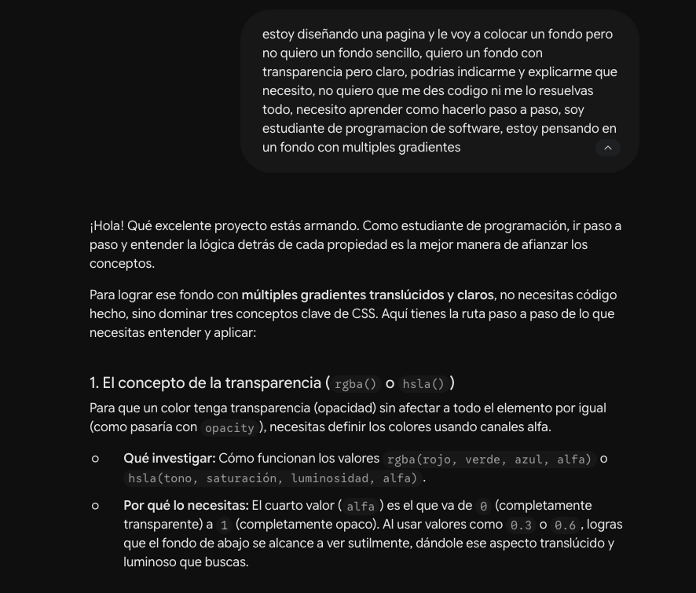

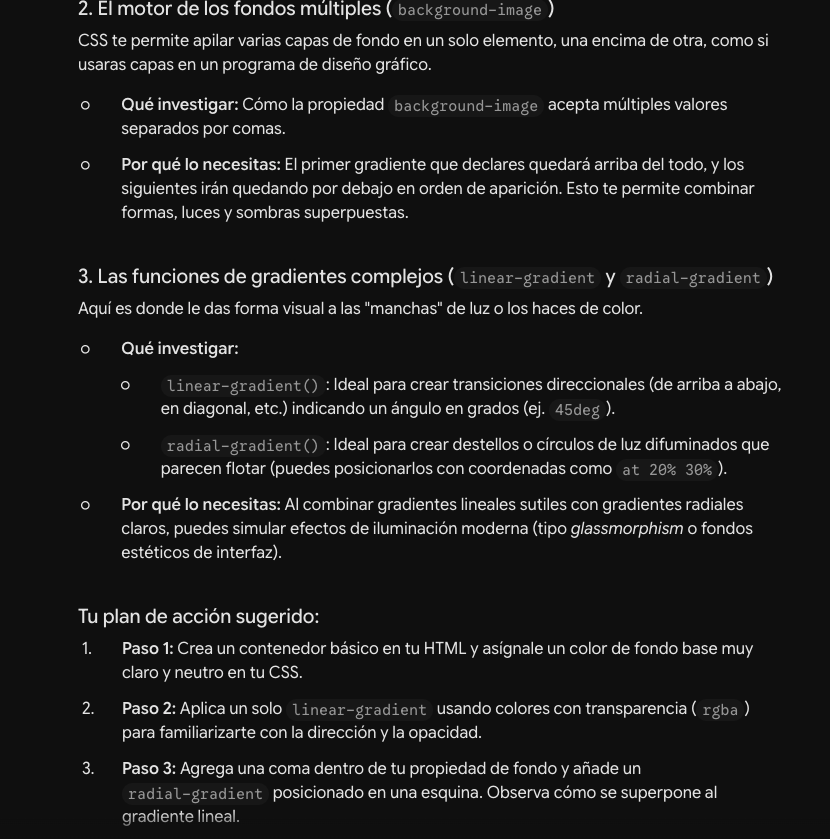

---

### Consulta 2. Conversión de colores HSL y HEX

**¿Qué necesitaba?**

Mi aplicación trabajaba con colores y quería ofrecer la posibilidad de visualizar sus códigos en formato HSL y hexadecimal.

**¿Cómo me ayudó la IA?**

Gemini me explicó la relación entre HSL, RGB y HEX, y los pasos necesarios para realizar conversiones entre estos formatos.

**¿Cómo lo apliqué?**

Implementé un selector para visualizar los colores en HEX o HSL. En la versión desarrollada, los colores se generan en HEX y se convierten a HSL cuando el usuario selecciona ese formato.

**Evidencia:**

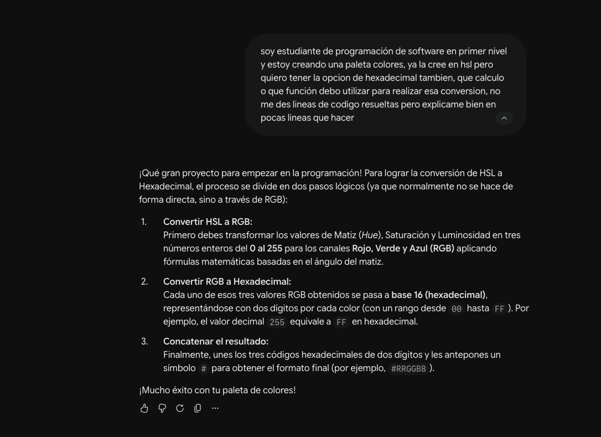

---

### Consulta 3. Creación del historial de paletas

**¿Qué necesitaba?**

Quería guardar las paletas generadas para poder recuperarlas posteriormente, sin perder sus colores originales.

**¿Cómo me ayudó la IA?**

Gemini me explicó la importancia de crear copias independientes de los arreglos para evitar que las modificaciones de una paleta afectaran las anteriores.

También me mostró cómo utilizar `localStorage`, `JSON.stringify()` y `JSON.parse()` para guardar y recuperar información del navegador.

**¿Cómo lo apliqué?**

Implementé un historial que permite guardar hasta 10 paletas y recuperarlas mediante un selector.

**Evidencias:**

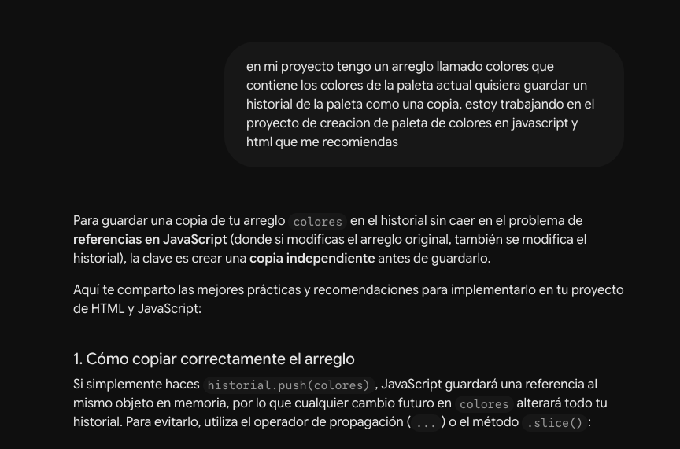

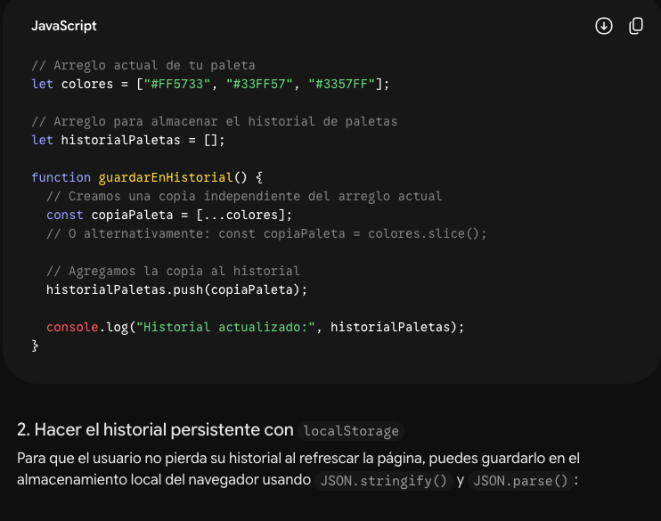

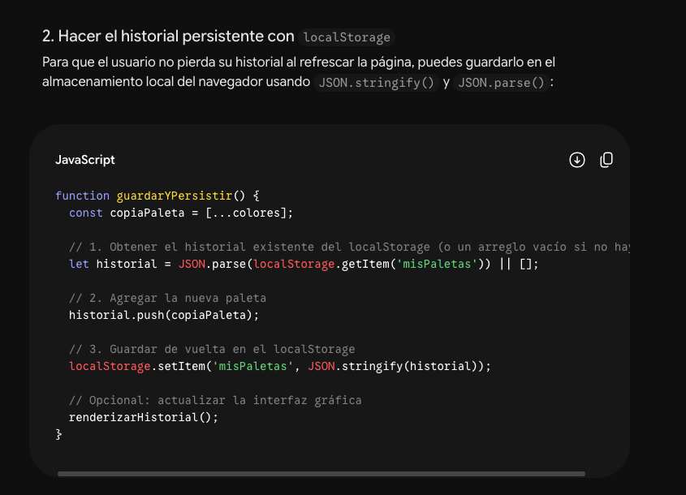

---

### Consulta 4. Animaciones de las tarjetas

**¿Qué necesitaba?**

Quería agregar animaciones a las tarjetas de colores para que la aplicación tuviera una presentación más dinámica.

**¿Cómo me ayudó la IA?**

Gemini me explicó cómo funcionan las animaciones y transiciones en CSS, utilizando propiedades como `transition`, `transform` y `hover`.

**¿Cómo lo apliqué?**

Después de conocer estas alternativas, incorporé una animación suave de aparición de las tarjetas mediante JavaScript.

**Evidencias:**

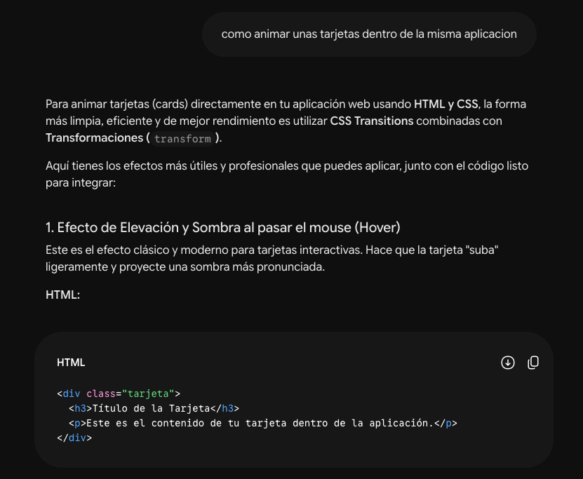

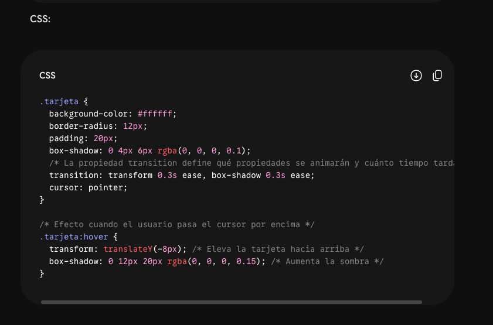

---

### Consulta 5. Control de las animaciones

**¿Qué necesitaba?**

Quería controlar cuándo se ejecutaba la animación, porque no necesitaba que apareciera cada vez que se actualizaba la visualización de la paleta.

**¿Cómo me ayudó la IA?**

Gemini me explicó el funcionamiento del parámetro `animar = false` y cómo utilizar valores booleanos para decidir cuándo ejecutar una animación.

**¿Cómo lo apliqué?**

Utilicé este concepto para ejecutar la animación al generar nuevos colores, pero no al cambiar el formato o recuperar una paleta del historial.

**Evidencia:**

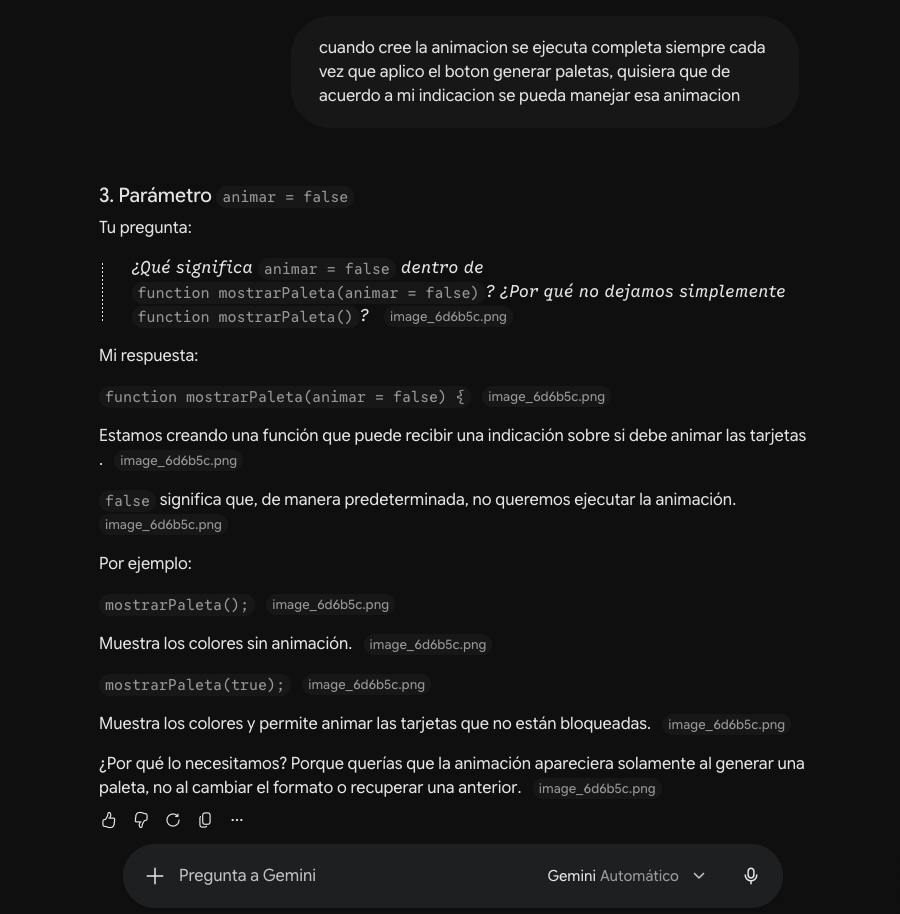

---

### Consulta 6. Evitar animaciones en colores bloqueados

**¿Qué necesitaba?**

Cuando generaba una nueva paleta, los colores bloqueados también mostraban un efecto de aparición. Quería que permanecieran visualmente sin cambios.

**¿Cómo me ayudó la IA?**

Gemini me explicó cómo utilizar una condición para comprobar si la animación estaba activada y si el color no estaba bloqueado.

La condición utilizada fue:

`if (animar && !color.bloqueado)`

**¿Cómo lo apliqué?**

Utilicé esta condición para que solamente se animaran los colores que podían cambiar al generar una nueva paleta.

**Evidencia:**

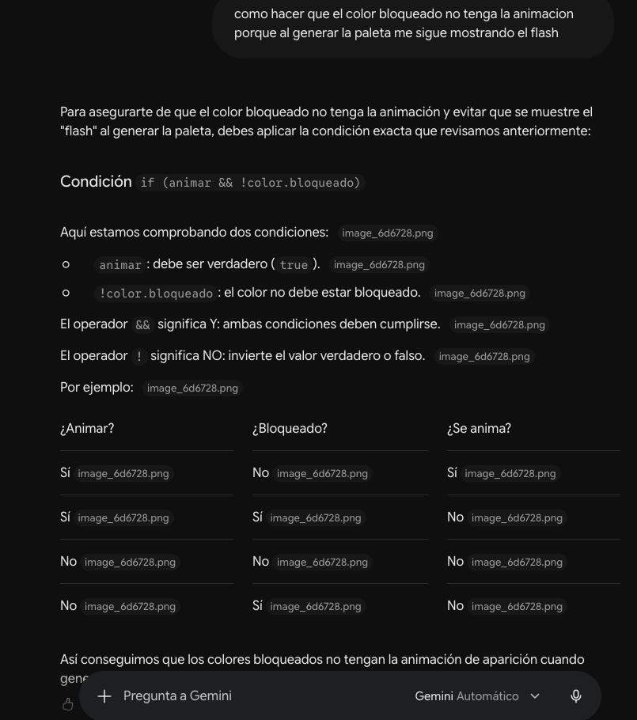

---

### Consulta 7. Validación de arreglos con Array.isArray()

**¿Qué necesitaba?**

Quería comprender para qué se utilizaba `Array.isArray()` dentro de mi código.

**¿Cómo me ayudó la IA?**

ChatGPT me explicó que este método permite comprobar si una variable contiene un arreglo y devuelve `true` o `false`.

También me mostró ejemplos y explicó su utilidad dentro de Colorfly Studio.

**¿Cómo lo apliqué?**

Lo utilicé para verificar que la información recuperada de `localStorage` tuviera la estructura de un arreglo antes de asignarla al historial o a la paleta.

**Evidencias:**

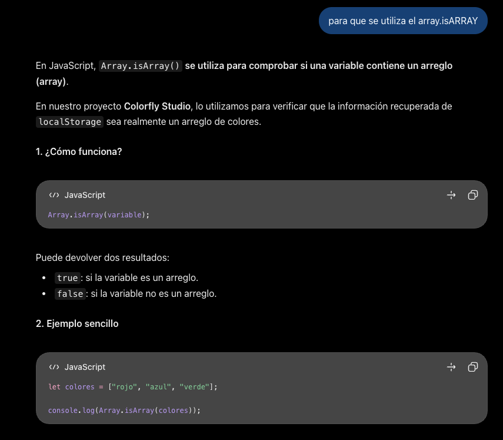

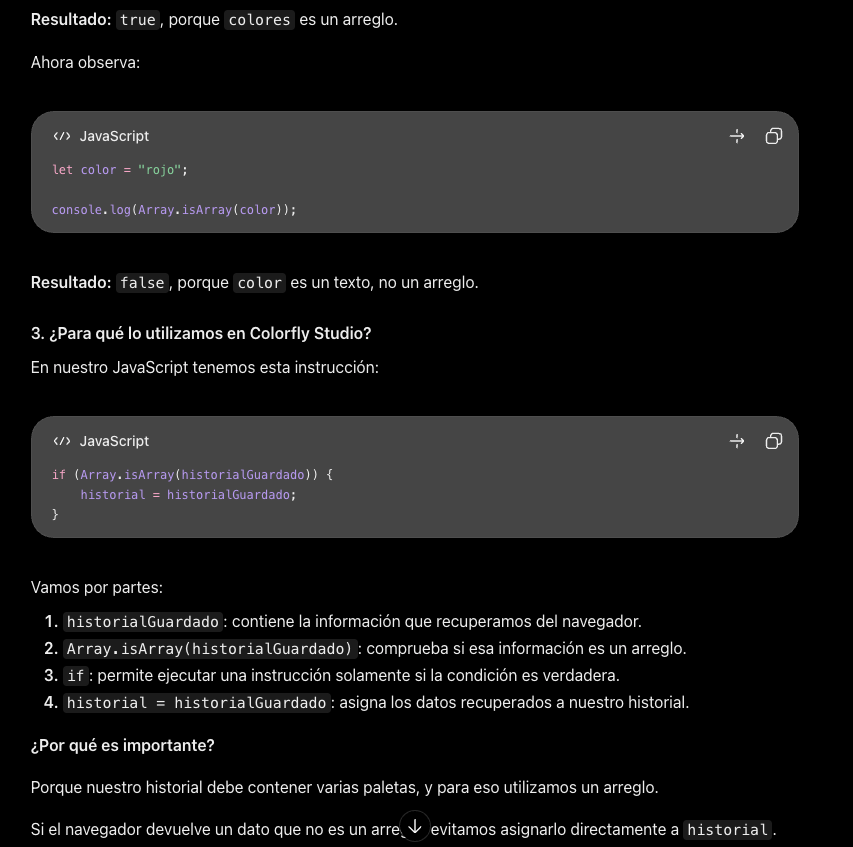

---

### Consulta 8. Método every() para revisar arreglos

**¿Qué necesitaba?**

Necesitaba conocer un método de JavaScript que permitiera revisar todos los elementos de un arreglo.

**¿Cómo me ayudó la IA?**

ChatGPT me explicó que `.every()` comprueba si todos los elementos cumplen una condición y devuelve un valor booleano.

También conocí otros métodos como `.some()`, `.forEach()` y `.find()`.

**¿Cómo lo apliqué?**

Utilicé `.every()` para comprobar que los elementos de una paleta recuperada tuvieran las propiedades y los tipos de datos esperados.

**Evidencia:**

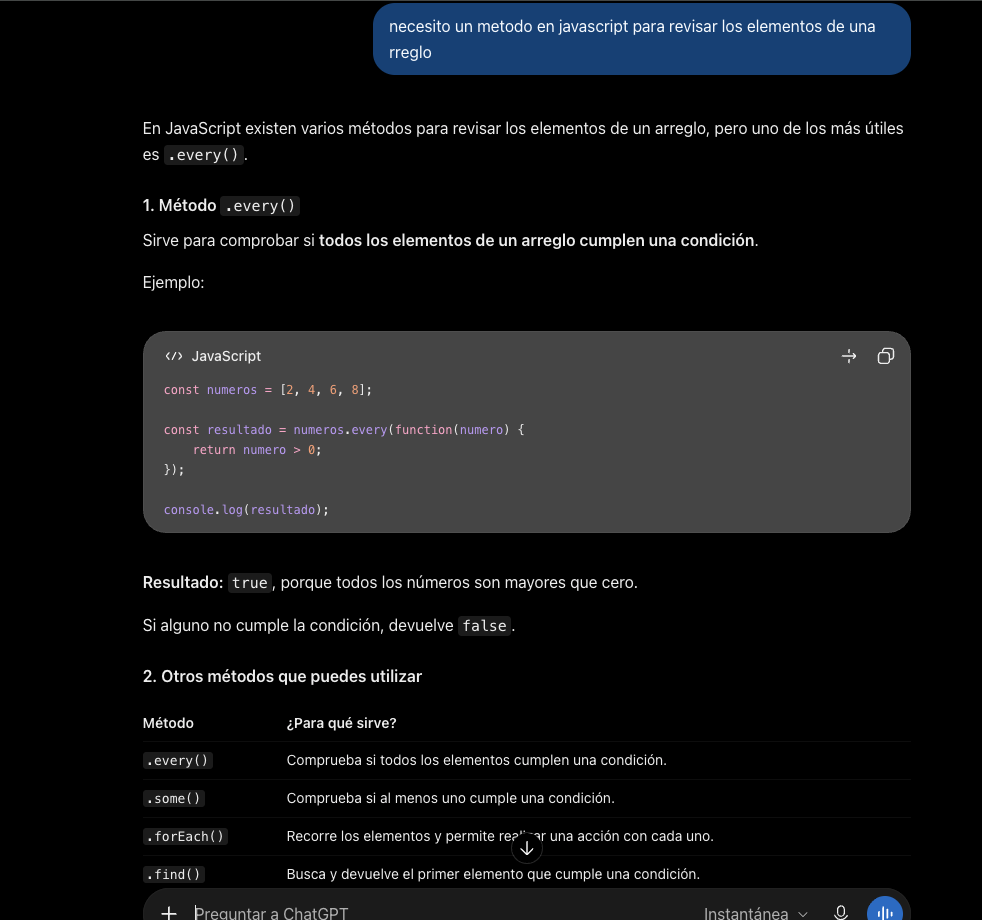

---

### Consulta 9. Validación de códigos hexadecimales

**¿Qué necesitaba?**

Quería comprender el funcionamiento de una expresión regular que aparecía en mi código:

`/^#[0-9A-F]{6}$/i.test(color.hex)`

**¿Cómo me ayudó la IA?**

ChatGPT me explicó cada símbolo de la expresión y cómo permite comprobar que un código hexadecimal comience con `#` y tenga seis caracteres válidos.

**¿Cómo lo apliqué?**

Utilicé esta validación para comprobar que los códigos HEX recuperados del navegador tuvieran un formato correcto.

**Evidencias:**

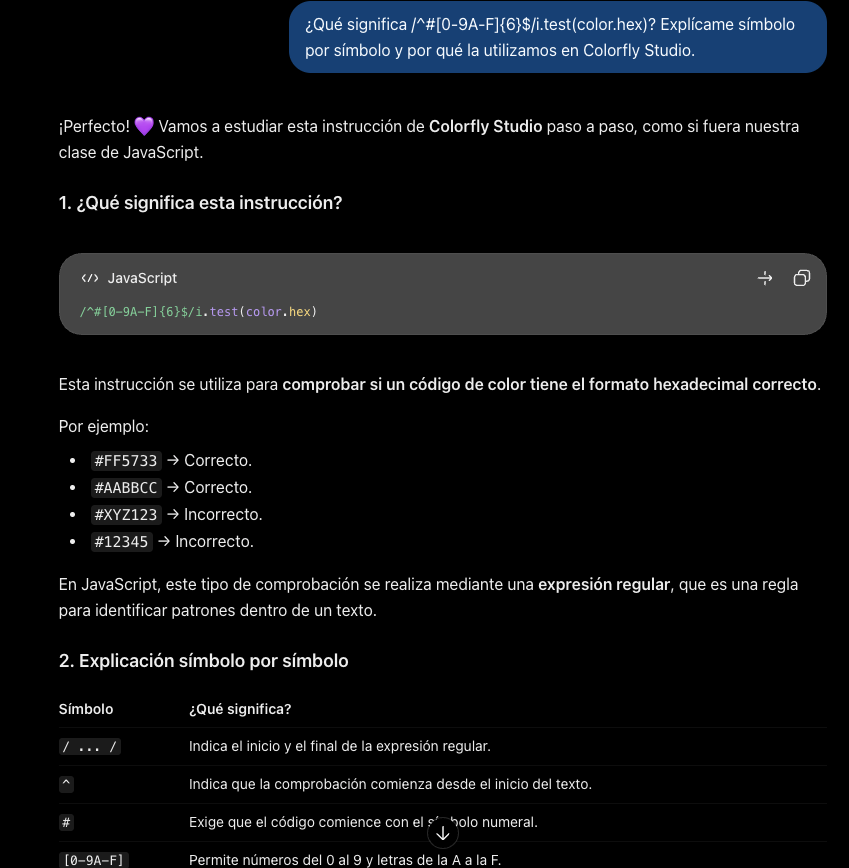

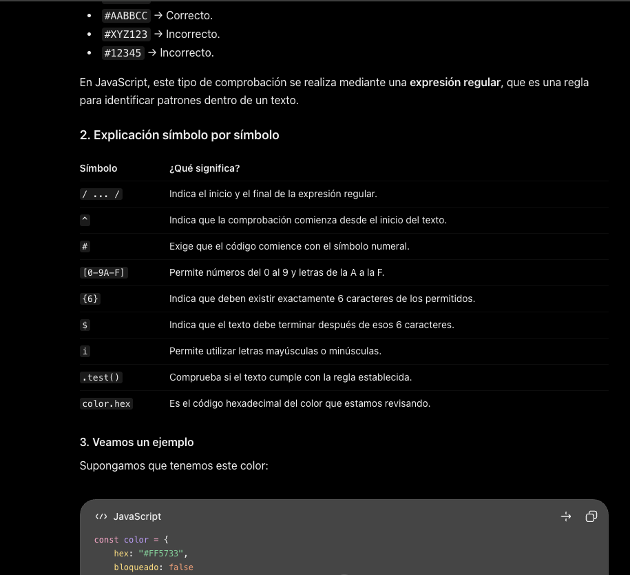

---

### Consulta 10. Comprensión de la función convertirAHsl()

**¿Qué necesitaba?**

Quería entender cómo funcionaba la conversión de colores HEX a HSL dentro de mi aplicación.

**¿Cómo me ayudó la IA?**

ChatGPT me explicó paso a paso cómo convertir HEX a RGB y posteriormente a HSL.

Utilizó como ejemplo el color `#FF5733` y explicó operaciones como `parseInt()`, `slice()`, `Math.max()`, `Math.min()` y `Math.round()`.

También me explicó las fórmulas utilizadas para calcular el tono, la saturación y la luminosidad.

**¿Cómo lo apliqué?**

Esta explicación me permitió comprender mejor la función `convertirAHsl()` utilizada en Colorfly Studio para mostrar los códigos HSL.

**Evidencias:**

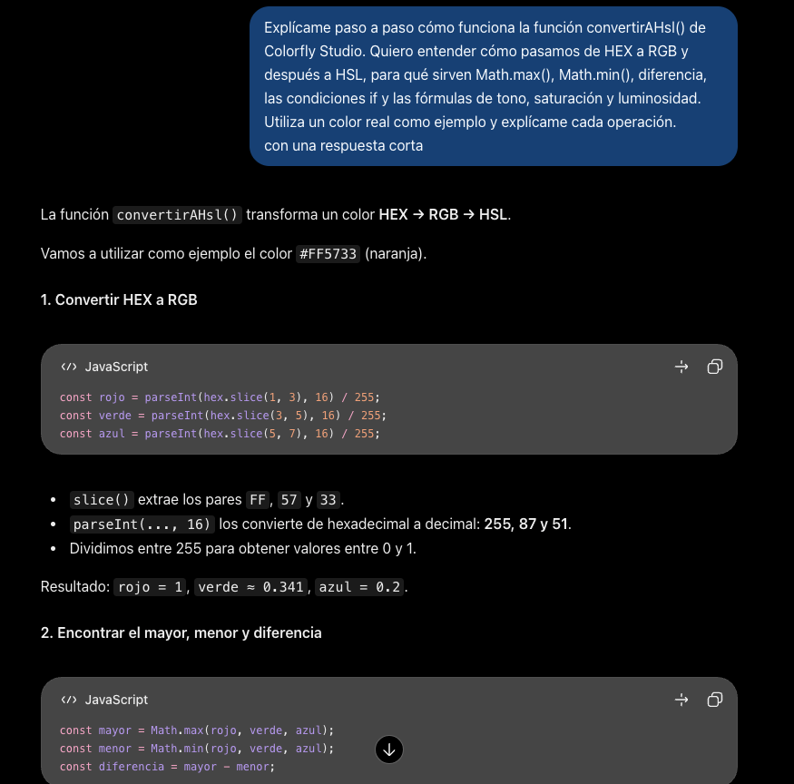

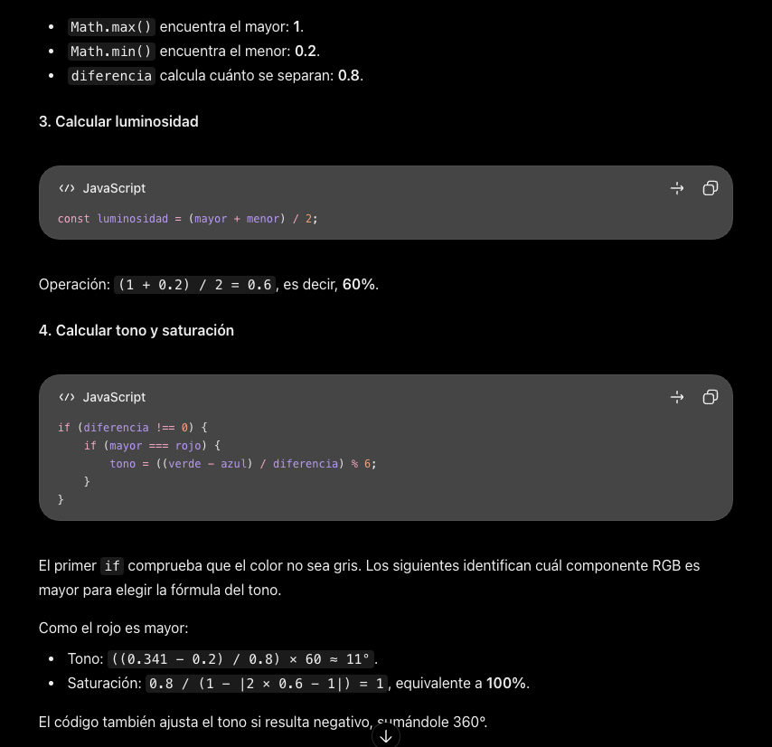

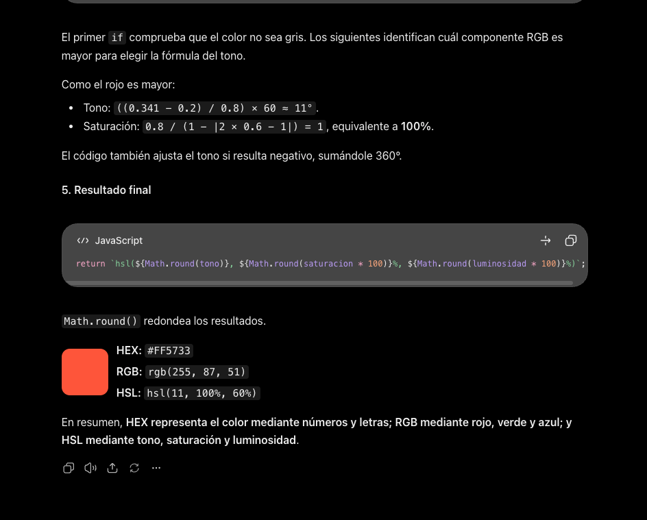

---

## 3. Aprendizajes obtenidos

Durante el desarrollo de Colorfly Studio, el uso de inteligencia artificial me permitió comprender mejor diferentes conceptos de programación.

Entre los principales aprendizajes se encuentran:

- Uso de gradientes y transparencias en CSS.
- Conversión entre formatos de colores.
- Manejo de arreglos y sus métodos en JavaScript.
- Almacenamiento de información mediante `localStorage`.
- Validación de datos y expresiones regulares.
- Uso de condiciones y valores booleanos.
- Control de animaciones en elementos de la página.

También aprendí a formular preguntas específicas y solicitar explicaciones paso a paso para comprender el funcionamiento de las instrucciones.

## 4. Conclusión

La inteligencia artificial fue una herramienta de apoyo durante el desarrollo de Colorfly Studio.

Me ayudó a resolver dudas, comprender conceptos de programación y conocer alternativas para desarrollar diferentes funcionalidades.

Las consultas no se limitaron a solicitar código, sino que también estuvieron orientadas a comprender cómo funcionan las instrucciones y por qué se utilizan.

Las capturas presentadas en este documento muestran parte de mi proceso de aprendizaje y cómo utilicé la inteligencia artificial como herramienta de consulta durante el desarrollo del proyecto.