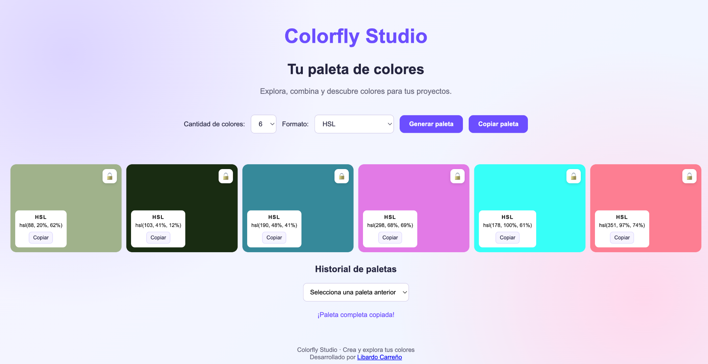
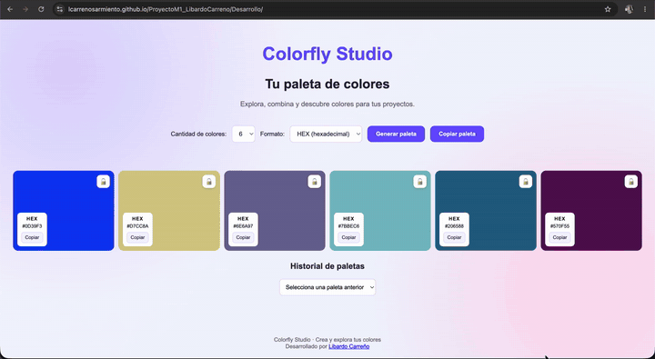
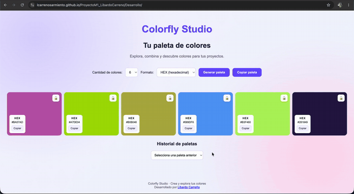
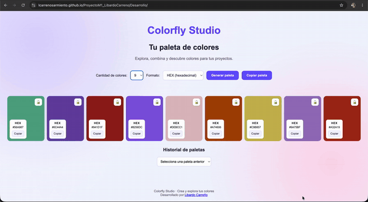
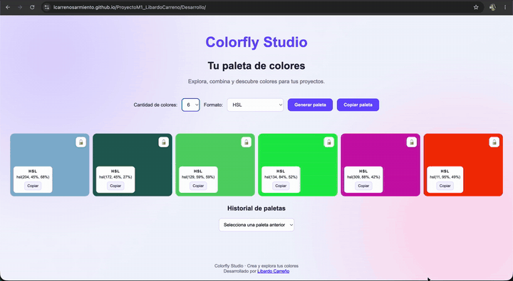
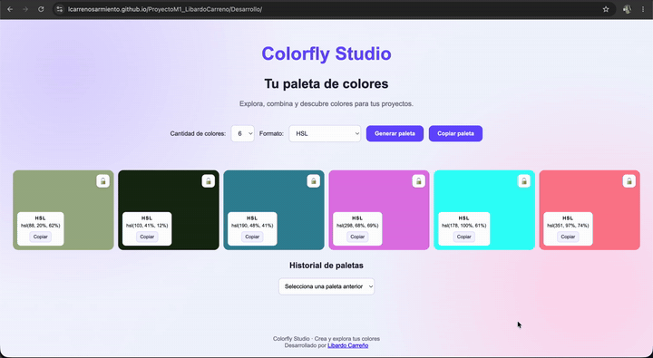
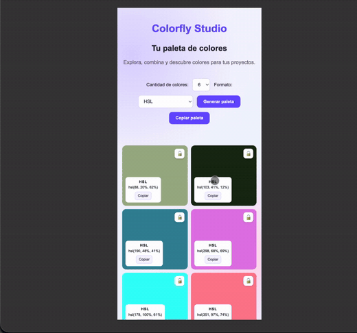

# Colorfly Studio 🎨

**Enlace de la aplicación:**

[Ver Colorfly Studio en GitHub Pages](https://lcarrenosarmiento.github.io/ProyectoM1_LibardoCarreno/Desarrollo/)

## 1. Descripción del proyecto

Colorfly Studio es una aplicación web que permite generar paletas de colores aleatorios de manera sencilla e interactiva.

Este proyecto fue desarrollado como parte de mi proceso de aprendizaje de programación de software, utilizando HTML, CSS y JavaScript.

La aplicación permite generar diferentes combinaciones de colores, consultar sus códigos en formato HEX o HSL, bloquear colores, copiar códigos y recuperar paletas generadas anteriormente.

## 2. Tecnologías utilizadas

- **HTML:** permite crear la estructura de la página y sus elementos.
- **CSS:** se utiliza para diseñar la interfaz, organizar las tarjetas y adaptar la aplicación a diferentes tamaños de pantalla.
- **JavaScript:** permite generar los colores, realizar conversiones, controlar los botones y gestionar las funcionalidades.
- **localStorage:** permite guardar la paleta actual y el historial en el navegador.

## 3. Funcionalidades de Colorfly Studio

### 3.1. Página principal

Al abrir Colorfly Studio, se muestra una paleta inicial de seis colores junto con los controles principales de la aplicación.



### 3.2. Generación de paletas

El botón **Generar paleta** permite crear nuevas combinaciones de colores aleatorios.

Cada color se presenta en una tarjeta que muestra su código y las opciones disponibles.



### 3.3. Selección de cantidad de colores

La aplicación permite seleccionar paletas de 6, 8 o 9 colores.

Al cambiar la cantidad, las tarjetas se organizan automáticamente según el número seleccionado.



### 3.4. Formatos HEX y HSL

Colorfly Studio permite visualizar los colores en dos formatos:

- **HEX:** representa los colores mediante números y letras en formato hexadecimal.
- **HSL:** representa los colores mediante tono, saturación y luminosidad.

Los colores se generan en HEX y se convierten a HSL cuando el usuario selecciona ese formato.



### 3.5. Bloqueo de colores y nuevas combinaciones

Cada tarjeta tiene un botón con un candado que permite bloquear o desbloquear el color.

Cuando un color está bloqueado, conserva su posición y su valor al generar una nueva paleta.

Los colores que no están bloqueados cambian y presentan una animación suave.



### 3.6. Copiar colores individuales y paletas completas

La aplicación permite copiar el código de un color individual haciendo clic en su tarjeta o en el botón **Copiar**.

También cuenta con el botón **Copiar paleta completa**, que permite copiar todos los códigos de la paleta actual.

Los códigos se copian de acuerdo con el formato seleccionado, HEX o HSL.



### 3.7. Historial de paletas

Colorfly Studio guarda automáticamente las últimas 10 paletas generadas.

Mediante el selector **Historial de paletas**, el usuario puede recuperar combinaciones anteriores.

El historial se guarda utilizando `localStorage`, por lo que permanece disponible al actualizar o volver a abrir la página en el mismo navegador, siempre que no se borren los datos almacenados.

### 3.8. Diseño adaptable

La aplicación utiliza CSS Grid para organizar las tarjetas de colores.

Su diseño se adapta a diferentes tamaños de pantalla, permitiendo utilizar Colorfly Studio desde computadores, tabletas y dispositivos móviles.



## 4. Cómo utilizar la aplicación

1. Abrir Colorfly Studio en el navegador.
2. Seleccionar la cantidad de colores: 6, 8 o 9.
3. Elegir el formato de visualización: HEX o HSL.
4. Presionar el botón **Generar paleta**.
5. Bloquear los colores que se quieran conservar utilizando el candado.
6. Copiar un color individual mediante el botón **Copiar**.
7. Utilizar **Copiar paleta completa** para copiar todos los códigos.
8. Consultar el historial para recuperar una paleta anterior.

## 5. Estructura del proyecto

El proyecto está organizado en las siguientes carpetas y archivos:

```text
ProyectoM1_LibardoCarreno/
│
├── readme.md
│
├── Desarrollo/
│   ├── index.html
│   ├── style.css
│   └── script.js
│
└── Documentacion/
    ├── imagenes/
    ├── imagenesFlujoPrincipal/
    │   ├── 00-inicio.png
    │   ├── 01-generar-paleta.gif
    │   ├── 02-cantidad-colores.gif
    │   ├── 03-cambiar-formato.gif
    │   ├── 04-nuevas-paletas.gif
    │   ├── 05-copiar-colores.gif
    │   └── 06-vista-movil.gif
    └── USO_IA.md
```

**Descripción de los archivos principales:**

- `index.html`: contiene la estructura de la aplicación.
- `style.css`: contiene los estilos y el diseño visual.
- `script.js`: contiene las funciones y la lógica de JavaScript.
- `imagenesFlujoPrincipal`: contiene las capturas y GIF que muestran las funcionalidades.
- `USO_IA.md`: documenta el uso de herramientas de inteligencia artificial durante el desarrollo.
- `readme.md`: presenta la descripción, las funcionalidades y las instrucciones del proyecto.

## 6. Cómo ejecutar el proyecto localmente

Para ejecutar Colorfly Studio en un computador, se deben seguir estos pasos:

1. Ingresar al [repositorio del proyecto en GitHub](https://github.com/lcarrenosarmiento/ProyectoM1_LibardoCarreno).
2. Hacer clic en el botón verde **Code**.
3. Seleccionar la opción **HTTPS**.
4. Copiar el enlace del repositorio.
5. Abrir Visual Studio Code.
6. Abrir la terminal de Visual Studio Code.
7. Escribir el comando `git clone`, seguido del enlace copiado.

Ejemplo:

```bash
git clone https://github.com/lcarrenosarmiento/ProyectoM1_LibardoCarreno.git
```

8. Abrir la carpeta del proyecto clonado en Visual Studio Code.
9. Ingresar a la carpeta `Desarrollo`.
10. Abrir el archivo `index.html` utilizando la extensión **Live Server**.
11. La aplicación se abrirá en el navegador y estará lista para utilizarse.

**Requisitos:**

- Tener Git instalado.
- Tener Visual Studio Code.
- Tener instalada la extensión Live Server.

No es necesario instalar librerías adicionales para ejecutar el proyecto.

## 7. Publicación con GitHub Pages

Colorfly Studio puede publicarse mediante GitHub Pages para acceder a la aplicación desde un navegador.

Para realizar la publicación:

1. Ingresar al repositorio de GitHub.
2. Abrir **Settings**.
3. Seleccionar **Pages**.
4. En **Build and deployment**, seleccionar **Deploy from a branch**.
5. Elegir la rama `main` y la carpeta `/ (root)`.
6. Guardar los cambios.

Como los archivos de la aplicación se encuentran dentro de la carpeta `Desarrollo`, se accede a ella desde la dirección publicada del repositorio.

## 8. Objetivo de aprendizaje

El objetivo principal de este proyecto fue poner en práctica los conocimientos adquiridos durante el aprendizaje de HTML, CSS y JavaScript.

Durante su desarrollo trabajé con variables, funciones, arreglos, objetos, condicionales, ciclos, eventos, manipulación del DOM, conversión de colores y almacenamiento local.

También aprendí a organizar los archivos del proyecto, utilizar GitHub, documentar el desarrollo y publicar una aplicación web.

## 9. Autor

**Libardo Carreño**

Proyecto Integrador M1 
Colorfly Studio · Crea y explora tus colores.

---

## 10. Documentación del uso de inteligencia artificial

Durante el desarrollo de Colorfly Studio utilicé herramientas de inteligencia artificial como ChatGPT y Gemini para comprender conceptos de programación, resolver dudas y aprender a implementar diferentes funcionalidades.

Estas herramientas me ayudaron a estudiar temas como el diseño de fondos con gradientes, la conversión de colores, el almacenamiento local, las animaciones y la validación de datos.

Las consultas realizadas, las explicaciones recibidas y las capturas de pantalla que evidencian este proceso se encuentran organizadas en un documento independiente.

**[Ver documentación y evidencias del uso de inteligencia artificial](Documentacion/USO_IA.md)**